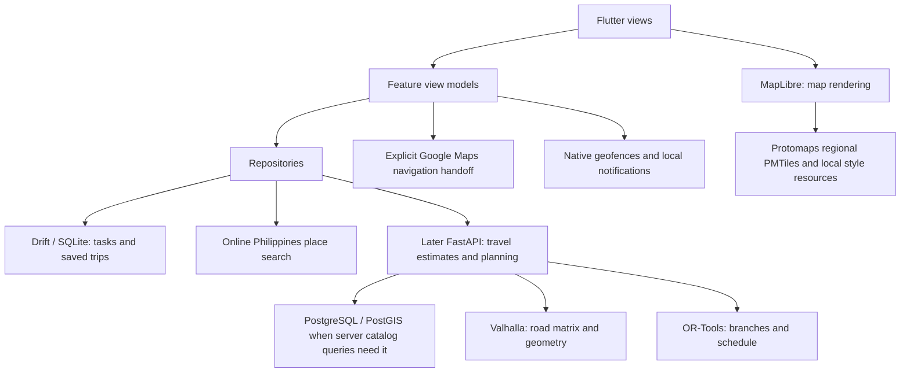

# Planned architecture

Status, 2026-10-27: Android Today, Recurring, and local Drift/SQLite persistence exist at `apps/mobile/`; the browser preview remains in memory. Reconciliation adds an online search adapter, confirmed-place values, map pin selection, manual review, schema migration and legacy-workspace recovery. These additions require integrated Android verification before readiness is claimed. The measured local routing study and versioned planning contract remain feasibility evidence, not production planning. Rudy's bounded place service has been copied into `services/api/` for review; the app does not depend on it. See [README product requirements](../../README.md#product-requirements) and [Decisions](DECISIONS.md) for current product boundaries and rationale.

## Implemented private phone planner — D47

The owner authorized the focused plan after D46. `features/planning/` now separates typed interpretation, native visible candidates, road adapters, an isolate-safe scheduler and independent validator, preparation controller, versioned local accepted itineraries and embedded navigation. Schema v3 added accepted itineraries; schema v4 adds a bounded singleton for manual review trip settings. Both migrations are additive. Preparation does not overwrite source Today or the last accepted plan; stale revisions and cancelled work cannot be accepted. Route matrices/geometry/ETAs remain transient, while Google coordinate leases remain independently expiring.

The private debug interpreter uses native Android Keystore storage and a fixed Gemini HTTPS endpoint, not the unconfigured Firebase project or local backend. Release builds refuse that key path. The owner authorized a conservative finite paid-generation allocation after confirming Paid tier and roughly $4 credit. D47 owns limits and billing meaning; [implementation evidence](evidence/phone-planner-implementation-2026-10-30.md) owns executed checks and limitations. Historical proposed/future sections below remain reference context, not an assertion that the current phone depends on a laptop.

## Responsibility map before D42

This map records the target before the owner's Google direction. The next section explains D42's changes and the narrower configuration/qualification work actually implemented so far.



The phone owns personal state and offline regional map data. Per D35, the initial place search is online and Philippines-wide through a Photon-compatible adapter; coverage and reliability still require qualification. A later backend provides real road estimates and automatic planning after feasibility. Map rendering, place search, road routing, stop scheduling, and external navigation are separate responsibilities. Reminder delivery remains later platform work.

## Google direction and current integration boundary

D42, selected on 2026-10-29, revises the pre-Google target shown above: Google Places UI Kit is now the initial search source under D43, with an explicit Other sources group; Google Routes supplies traffic-aware planner inputs; an embedded Navigation SDK view replaces external navigation as the intended primary trip experience. Route review based on Google data uses a Google map, while existing MapLibre/manual/offline functionality remains separate. The Valhalla evaluation and OR-Tools scheduling specification are preserved; they are not an implemented Google planner or a source of Google traffic. The five profile requirements still need engine/data qualification.

The earlier credential slice implemented configuration and tool-based Routes qualification. D43 now adds the native search bridge described below; Routes remains disconnected from the planner. The shared ignored Flutter defines file now supports the separate Android SDK and Routes keys. Gradle decodes only the Android SDK key into manifest metadata; the earlier credential slice did not install a Google SDK. D43 now pins Places SDK 6.0.2 and initializes it for explicit UI Kit bindings. A standalone bounded REST probe sends package/certificate headers and checks correct and rejected identities for route requests, plus one correct one-element matrix. It is not an application provider or scheduler and never runs at startup, in automated tests, on the phone's location, or in the background. Its report stores only technical counts/statuses, not Google route data or keys. Follow the [mobile README](../../apps/mobile/README.md#google-credential-configuration-and-routes-qualification) for configuration, quota limitations and deliberate repeat qualification. A future direct adapter must recheck endpoint identity enforcement, keep requests bounded, and stop safely on failure. Public distribution and shared accounting remain separate work.

## Phone-only planning boundary — D44, proposed

D45 selects Gemini interpretation and D46 records the owner-requested [Plan my day implementation plan](PLANNING.md). That plan owns the current interface/implementation sequence and presentation-mode qualifications; this document continues to own architectural responsibilities. Neither document establishes runtime readiness.

The owner's 2026-10-30 requirement is a phone-and-internet presentation without a reachable laptop. The phone coordinates place discovery, direct restricted Routes requests, bounded branch/stop scheduling and local persistence. A proposed pure Dart scheduler runs in a worker isolate so calculation does not block editing. Google services supply place and road data; the phone supplies task interpretation, dependency rules, branch comparison and timing validation. The local FastAPI service, PostGIS, Valhalla and OR-Tools remain independent historical/future options rather than runtime dependencies of this flow.

The [mobile planning handoff](evidence/planning-contract-v1.md#phone-only-planning-handoff-2026-10-30) defines the proposed inputs, shared stops, candidate presentation, resource bounds, retention review and verification. Its design has not been implemented or benchmarked. The older backend sections and HTTP interfaces below apply only if a backend is separately authorized. Existing v1 schema/examples remain historical specifications; a versioned mobile extension is required before shared-stop implementation.

## Frontend: features with MVVM

Organize the mobile application around errands, templates, planning, trips, places, and settings. Views display state; Riverpod-backed view models coordinate actions; repositories own data access and caching. Extract domain logic when scheduling or editing behavior would otherwise spread across view models. Avoid a separate abstraction for every simple function.

The frontend root is `apps/mobile/`. The shell uses `app/`, `core/data/` for the Drift database and local startup, shared `core/widgets/`, `features/errands/` for common models/list/editor, and `features/today/` plus `features/recurring/` with Riverpod controllers and repositories. Android repositories persist user changes in SQLite; web preview repositories remain in memory. The broader feature layout below remains planned; create directories when their implementation needs them:

```text
apps/mobile/lib/
  app/                 bootstrap, navigation, theme
  core/                database, network, platform adapters
  features/
    errands/           presentation, domain, data as needed
    recurring/
    planning/
    trips/
    places/
    settings/
```

Widgets do not call SQL or provider APIs directly. Repository contracts return application models rather than provider-specific objects. Cross-feature operations use shared contracts or explicit application services rather than importing another feature's widgets.

The map feature retains the regional offline-package validator and renderer, and adds an online MapLibre pin-selection surface. Every endpoint/errand/saved-place picker uses an application-scoped combined search service. Provider adapters normalize requests/results; per-provider schedulers share quotas, in-flight work and expiring memory caches across pickers. Controllers own input revisions and progressive result snapshots. Geoapify and LocationIQ support name/category searches; Photon supports name search in this pilot. Each actual request reserves durable local accounting before dispatch; storage failure prevents uncounted requests. Accounting contains no queries, coordinates, or credentials. Per-installation safeguards are insufficient for shared-account public distribution; a gateway remains a release prerequisite. Provider and attribution metadata extend existing JSON without a schema migration. Camera movement updates search context but never sends a search or changes typed text. Explicit category search-area actions snapshot the new context. Neither search nor rendering calculates routes or establishes business accuracy.

The shared errand model retains plain-text notes and independent copies. Today settings, errands, Recurring groups and saved places are stored locally on Android. Schema version 2 adds place and errand details without replacing version-1 rows. The recovery flow reads Rudy's workspace and imports into a separate database; when both databases exist, users choose the source and both originals remain. Save failures expose retry. Web preview state remains in memory; no synchronization outbox or account system is present.

D45 selects Gemini-assisted sentence interpretation for English, Filipino and Taglish errands and notes. Note entry, original text, explicit fields and structured correction remain local and usable offline; new model interpretation requires its online integration. Keep suggestions separate from confirmed values and review new errands/dependencies before applying them. The phone validates the resulting structured constraints; neither model output nor a possible later backend may silently overwrite confirmed values. The credential is stored locally for development only, without being added to Flutter build defines or the manifest; model and protected runtime integration remain pending.

### Current location-aware search

For Today From/To, confirming a manually placed unnamed pin commits its coordinates immediately, then schedules a Geoapify reverse lookup through the existing shared Geoapify runner and quota ledger. The same runner serializes search and reverse requests, reserves before dispatch, and applies its existing cooldowns and memory TTLs. The endpoint view owns the transient lookup state and invalidates callbacks on replacement, reopening, backgrounding, disposal or an eight-second wait. A nearby returned street (within 100 meters) or locality becomes the stored label; returned business names, house numbers and provider coordinates are not treated as the selected pin. Returned non-Philippine or insufficient data is discarded. A failed lookup retains the pin and offers a personal label. Derived labels retain provider credits and retrieval time in existing JSON; no database migration or durable query history is added.

Each open picker now retains independent Google and Other sources presentation sessions. Context revisions change for input/interpretation/category/origin invalidation, not source activation. A source session owns provider states, request identity, visible rows, frozen/staged updates and its displayed distance origin. Source switching pauses undispatched jobs but retains subscriptions to dispatched jobs; valid hidden completions populate their own session. Other sources cancellation can target providers, so resuming paused providers does not detach another provider's active response. An explicit refresh bypasses the Other sources response cache through the same scheduler and quota ledger. This does not change cache TTLs or provider policy.

The Flutter search panel lazily mounts one Google platform view and retains it offstage until the picker closes. The bridge's presentation-only visibility message changes native visibility, descendant focus and accessibility without binding requests or removing fragments. Query changes and closing still destroy obsolete native result fragments. Google retains standard native records rather than a custom response cache. Loaded results do not expire merely because another source is visible; closing releases the presentation sessions. Backgrounding invalidates callbacks and pending work while preserving completed sessions; only subsequent user actions resume searches. Failed or interrupted states do not retry merely because they are shown again. No durable query history or storage migration is introduced.

The application-scoped search-location controller separates permission checks, explicit consent and bounded coordinate acquisition through an injectable platform adapter. Every picker shares its in-flight acquisition and recent memory-only fix. Opening search refreshes already-authorized location; it does not prompt automatically. Background callbacks are invalidated and revoked access clears reuse. Search origin is an immutable device/map snapshot, separate from the live viewport and confirmed draft. Map-origin searches require explicit selection; camera callbacks alone never send provider requests. A materially changed fix can replace queued work or cause at most one replacement wave per query after dispatch, with existing provider accounting and cache identities retained.

Provider batches feed a pure ranking component and conservative deduplication before the thirty-row limit. Matching normalization and the bounded alias registry do not change display text or manufacture provider records. Optional brand, alternate-name and locality fields remain transport/ranking metadata; confirmed places preserve one complete source record and all applicable credits through existing JSON. Precise distances are rounded straight-line estimates; approximate locations use uncertainty buckets. Controllers retain visible records and their distance origin after pointer, scroll or accessibility focus, staging later batches behind a local Updated results action. Explicit origin/input changes reset the ranking session. The separate search/map location actions share acquisition while keeping draft selection and camera movement explicit.

The shared brand-term registry feeds result ranking, canonical provider text and request/cache identity. Recognized aliases such as Jolibee/Jollibee preserve branch/locality qualifiers and original display text. Branches can match by a bounded name prefix without provider brand metadata, keeping comparable nearby branches ahead of distant misspelled records. Alias variants share one retrieval/cache entry; adapters do not fan out into additional queries. LocationIQ requests distance sorting for registered brand-only queries, with the existing nationwide restriction and unbounded viewbox.

## Next local place and trip boundaries — planned

Use the provider-independent place value for start/end and errands: label, coordinates, optional address, source identity, and source snapshot date. The schema upgrade preserves unresolved legacy labels without inventing coordinates. Recurring copies retain independent place values. Verify upgrade and recovery behavior on Android as well as with synthetic databases.

Keep place search separate from the basemap: vector tiles omit or simplify source attributes and are not the search database. D35 selects online search across the Philippines; choose and validate a provider, filter by country rather than a rectangular approximation, and retain manual selection when unavailable. An installed regional catalog remains a possible later offline capability. Personal pins, notes, and corrections remain separate from replaceable public data. Preserve available provenance and do not overwrite personal edits.

A map package includes PMTiles, the matching style schema, fonts/glyphs, sprites, region bounds, versions, checksums, and license/attribution metadata. Install compatible map/catalog packages atomically and retain the last valid version after interruption or corruption. Record readiness and age. Complete offline rendering must be verified on Android; a remote PMTiles URL is still online.

Save the reviewed automatically planned trip snapshot before external navigation; user order/place changes are explicit overrides that invalidate affected estimates until recalculated. It includes stop coordinates, order, relevant errand details, profile, date/timezone, input revision, and completion state. Edits mark the snapshot stale. External Maps links do not establish arrival, completion, timing feasibility, or synchronization of a user's changes in Google Maps back into Wayday. Use next-stop handoff as primary and bounded whole-trip handoff as optional.

## Backend: modular monolith — later, conditional

Use a single FastAPI application with places, routing, and planning modules. HTTP handlers validate and delegate; services perform domain operations; repositories access PostGIS; adapters translate Valhalla responses. OR-Tools belongs behind the planning module's solver boundary.

The backend root `services/api/` currently contains the imported pilot place-search application under `src/wayday_api/`, plus tests, SQL migrations and import tools. It is not connected to the Flutter app and does not implement routing or planning. The broader domain structure and infrastructure folder below remain planned:

```text
services/api/
  src/wayday/
    core/              settings, database, common errors
    places/            catalog search and source metadata
    routing/           Valhalla adapter and matrix cache
    planning/          validation, solver, itinerary orchestration
  tests/
infra/                 future local deployment configuration
```

The later API may retain reusable route-cache data. Initial place search is intended to use an online provider under D35; a server catalog is optional and must not restrict nationwide search to the pilot. Personal tasks and trip history remain on the phone; plan requests are calculations, not an implicit cloud backup. Avoid logging full notes, home coordinates, or request bodies by default.

Set a solver time limit and bound concurrent work. Keep CPU-bound solves off the async event loop. Start without Redis, a message broker, or separately deployed application microservices; add a worker only if measured load requires one. Hosting Valhalla separately is an engine boundary, not a reason to split every domain module into a service.

## Interfaces to define when development starts

Use REST/JSON under `/v1`, with Pydantic models and generated OpenAPI when the API is implemented. The endpoints below remain future runtime boundaries; Stage 2 specifies the planning payloads without creating a server.

Stage 2 now supplies a versioned [planning contract specification](evidence/planning-contract-v1.md), [JSON Schema](evidence/planning-contract-v1.schema.json) and [synthetic acceptance examples](evidence/planning-contract-v1.examples.json) for the future planning/replanning boundaries. `wayday.planning.v1` separates editable day input from calculated snapshots, correlates request/revision, uses explicit Asia/Manila dates and instants, seconds/meters and provider-independent places. It defines the initial editable duration/buffer policy, single-day behavior, optional prerequisites, bounded candidates/calculation and distinct clarification/conflict/timeout/unavailable results. These are executable contract specifications under `tools/routing/`, not a deployed API, solver or changes to the current Flutter models. The personal-data schema and saved-trip implementation remain their later tasks.

| Interface | Input | Output |
| --- | --- | --- |
| `GET /v1/places` | Search text/category and bounded geographic area | Candidate places, coordinates, source date, opening-hours availability |
| `POST /v1/plans` | Day/date/timezone, start/end, departure/deadline, mode, structured errands, pinned branch choices | Status, selected branches, ordered stops, schedule, geometry, omissions, warnings, calculation time |
| `POST /v1/plans/replan` | Current position/time, completed stops, remaining errands and edits | Replacement schedule for unfinished work, with preserved completed history |
| `GET /health` | No personal data | Application health; distinguish dependency readiness if reported |

Represent the five user-facing choices as transportation profiles: walking, biking, motorcycle, sedan (low clearance), and truck (high clearance). Keep the selected profile separate from engine costing and any validated vehicle parameters. Thread the profile through planning, replanning, saved itinerary metadata, and route-cache identity. Include relevant restrictions and graph version in cache keys so incompatible matrices cannot be reused after a profile change. Public-commute routing is excluded.

The high-clearance category includes pickup/light and heavy delivery vehicle subtypes. Establish the relevant subtype, required dimensions/weight/access parameters, and actual engine/data support before enabling associated restrictions. Ground clearance is not overall vehicle height. A missing road restriction or surface attribute is unknown, not a verified passability result. The profile labels alone must not generate invented dimensions or a guarantee that a road is suitable.

Separate invalid input, missing place data, no road connection, proven infeasibility, solver timeout, and dependency outage. A response that needs review must not be presented as a fully confirmed plan. Exact error objects and limits are an implementation contract task, not invented compatibility guarantees in this foundation.

The first usable release requires system-recommended candidates, selected branches, ordered stops, and estimated timings. Add provider-independent planning input fields for errand category/interpretation state, flexible versus fixed destination, visit-duration estimate/user override, and relevant vehicle subtype/parameters. Keep original text and user-confirmed values; unresolved category or destination information triggers a focused clarification rather than requiring manual itinerary construction.

Use stable errand IDs for dependencies and template copies. Record dates and the IANA timezone (`Asia/Manila` initially); do not reuse the prototype's minutes-after-midnight fields as a complete date model. Treat durations as durations and appointments as local date/time constraints. Define overnight and recurrence edge cases before implementing them.

## Planning pipeline

1. Validate explicit times, durations, coordinates, references, and dependency cycles. Keep ambiguous interpretation outside the solver.
2. Retrieve a bounded set of relevant places for each flexible errand. Respect specific-place overrides and source freshness.
3. Fetch an asymmetric travel-time matrix for the requested mode. Preserve unreachable pairs; never replace them with zero or straight-line travel time.
4. Model branch alternatives, shared visits, business intervals, appointments, arrival/completion deadlines, service durations, buffers, waiting and dependencies in the proposed bounded on-device scheduler under D44. The earlier OR-Tools service remains a conditional future option.
5. Require exactly one candidate for each mandatory errand; allow at most one for an optional errand. Account for optional dependencies consistently when dropping visits.
6. Enforce hard feasibility first, then favor optional completion and lower travel time. Do not rely on an arbitrary penalty that permits dropping mandatory work.
7. Validate the returned schedule independently of solver construction. Obtain road geometry for the chosen sequence and attach estimate/source metadata.

Respect known business hours for the entire visit. Unknown hours may produce a provisional plan with a visible check-hours notice or explicitly sourced user correction; the model cannot prove availability from missing data. Visit durations use editable, labeled category estimates unless the user provides a value. Record estimate policy/version separately from observed business facts. Report a feasible solution as an optimized estimate, not a proof of global optimality. A time-limited search that finds nothing is not proof that no solution exists.

Replanning starts at the actual current location/time and retains completed history. Do not reroute through completed tasks or replace local edits with an obsolete in-flight response.

## Offline storage and reminders

Local writes to errands, templates, settings, and progress commit immediately to SQLite. Template copies receive their own IDs and remapped internal dependencies. Saving today's copy does not modify its template. No synchronization outbox is required until a server-persistence feature is introduced.

Persist a saved itinerary with stop coordinates, schedule, geometry, source/calculation timestamps, and the input revision it represents. Edits can make a saved plan stale; show this explicitly. Apply network results only to the input revision that requested them. Reconnection does not require silently recalculating or replacing the user's itinerary.

Map downloads include styles, tiles, fonts/glyphs, and sprites needed by the selected region. Verify completion and available storage. Recover gracefully when iOS clears cached tiles. An offline map does not imply offline road routing.

Use `flutter_local_notifications` for time reminders and native Android/iOS geofence APIs for location entry/dwell behavior. Keep a persistent reminder identity to prevent duplicate alerts and cancel stale reminders after replanning. Register relevant upcoming places rather than tracking every saved place.

Request permissions when the user enables the feature. Handle approximate location, denied notification/background access, disabled GPS, delayed delivery, process termination, and reboot. Re-register eligible reminders after restart where the OS permits. Provide time/manual alternatives when geofencing is unavailable. Do not promise exact alerts or guaranteed operation after a force-stop.

See [Android geofencing](https://developer.android.com/develop/sensors-and-location/location/geofencing) and [Apple geographic monitoring](https://developer.apple.com/documentation/corelocation/monitoring-the-user-s-proximity-to-geographic-regions). Apple limits simultaneous monitored conditions to 20; Android geofencing limits differ, so keep platform limits behind the adapter.

## Local deployment and scaling

The earlier proposal ran FastAPI, PostgreSQL/PostGIS and a regional Valhalla graph on the existing computer. D44 supersedes that dependency for the phone-only presentation: fresh scheduling must not require the computer. If an optional backend is separately adopted later, its availability, hosting and phone connectivity must be verified; a sleeping laptop remains an unavailable backend.

Document emulator, Android device, and iOS device networking separately. Localhost on a physical phone refers to that phone. Restrict any development HTTP exception to development builds. Do not expose an unauthenticated development API to the public internet.

Later, the API and route engine can move to suitable compute while PostgreSQL moves independently. Supabase is one database candidate. Before public deployment, measure memory, graph size, solver latency, database size, and network use; define access controls, rate limits, TLS, backups, and migration recovery. Free-tier eligibility does not establish that a service can run this workload.

## Verification strategy for later code

- Use fixed matrices to test mandatory/optional work, candidate selection, waiting, opening hours, arrive-by versus finish-before, final deadlines, dependencies, and replanning.
- Compare tiny solver cases with exhaustive enumeration; independently verify every produced schedule.
- Use fixtures for provider adapters, including unreachable legs, timeouts, rate limits, malformed data, and stale responses. Avoid routine tests against community endpoints.
- Exercise all five profiles, bicycle access, confirmed vehicle restrictions, missing clearance data, and profile changes that invalidate cached matrices. Verify that high ground clearance does not bypass truck access or overhead restrictions.
- Exercise SQLite migrations and offline restart with completed stops and edited templates.
- Verify maps and reminders on physical Android/iOS devices, including airplane mode, cache eviction, permission changes, and reboot. Simulator checks alone cannot establish background delivery.


## D43 native Google search and retention

The shared picker uses one pure NSI-backed interpreter before source-specific requests. Application-scoped SearchSourceChoice selects Google or Other sources. GoogleSearchService and CombinedPlaceSearch share one QuotaLedger with separate identities; the existing provider limits/caches remain unchanged. Google uses typed native revisions and selected snapshots rather than custom result batches.

GoogleSearchView hosts standard PlaceSearchFragment and PlaceDetailsCompactFragment in FlutterFragmentActivity using Android hybrid composition. Bindings change only after scheduling/reservation. Visible and staged fragments preserve exact records during interaction; Updated results shows a staged fragment locally. Disposal removes fragments and stale callbacks are ignored. The bridge passes selected IDs, coordinates, optional structured country status and native acquisition time to Dart, without copying returned business names/addresses. SDK 6.0.2 callback records omit country/address/name fields despite native card display, so a pinned 97-polygon Natural Earth Philippine land mask validates membership locally, with a conservative 250-meter shoreline exclusion. Unconfirmed coastal/small-island points fail closed and retain manual/Other sources fallback. Missing metadata permits one quota-controlled standard details resolution; invalid selections cannot commit.

PlaceIntent.providerReference and providerPlaceId survive without coordinates. Google JSON contains the user-owned label and static provenance/credit, while GooglePinCache stores temporary ID/coordinate/acquisition tuples in private Android cacheDir. Repositories bind restored references to shared revocable leases. Every coordinate getter checks expiry; foreground timers and lifecycle observers purge expired files, remove expired map markers and refresh Today. Copies into Today/Recurring retain the original acquisition time. Expired or evicted references remain editable and offer explicit online refresh; startup performs no saved-place network sweep.

The API-36 native build and bounded isolated Google sample now pass after test identity authorization. Callback metadata, selected pins, user-label retention and disposal were exercised. The real Android fixture keyboard check also passes; Google cards and attribution require visual review because callback records do not include their names/addresses. Routing, traffic displays and navigation are outside this integration.


D43's screenshot-based design restoration shares one set of source/origin/area controls, saved rows, status copy and full fallback actions across both source groups. Keyboard visibility only resizes the layout; it no longer substitutes a menu. Other sources keeps its lazy list; the Google host remains in a stable keyed Expanded slot between independently scrollable, content-sized controls and fallback regions. Those regions have height ceilings that preserve a 180-unit native viewport on normal panels, or 45 percent on panels of 400 units or less, without reserving empty space. Layout and typography do not change request bindings. Supported XML theme roles reuse Figtree and Cornflower without replacing/reordering native cards or altering attribution.


## D48 interpretation persistence boundary

The native Gemini request owner now also owns a bounded response journal in no-backup storage. Persisting there closes the completed-response/Flutter-screen-lifetime gap: pending precedes dispatch, completion precedes callback, and failed/pending outcomes block automatic replacement. A versioned canonical request selects an interpretation independently of routing state; every recovered answer is validated again by the Dart domain parser. This file is distinct from credentials, paid-request accounting, Drift source state and accepted itineraries. Its eight-snapshot cap limits storage without adding a schema migration or cloud state. Source/task edits cannot be overwritten by a stale result because the preparation controller retains its request epoch and the cache lookup uses the current submitted context.


### Review trip recovery and order projection — D52

Review's visible order and forward validation consume the same effective proposal projection over the original draft. This keeps selected After rules visible immediately without mutating Today or losing the baseline needed for reversal. Review trip settings have a separate repository: one source-hashed date/departure/deadline row in Drift, or an in-memory browser implementation. Writes and reads are serialized. A matching source restores before cache-first understanding; replanning/history bypasses this repository. Provider responses, route geometry and task edits are not stored in this row. A changed source invalidates it. Storage failures are explicit, and genuine past departures remain blocked with direct recovery controls.

### D53 review validation and clock retention

`planning_input_checks.dart` owns deterministic field and zero-road scheduling preflight. The request builder/controller reject structurally invalid source errands before interpretation; review and calculation use the shared scheduling checks before provider work. Calculation also rechecks departure expiry and dependency integrity. The bounded scheduler and road refinement remain authoritative for actual feasibility.

The v4 review snapshot's JSON may now include an `errandTimes` map keyed by source identity, containing only a timing enum and nullable minute for manually confirmed differences. Legacy three-field rows still read. Persist the manual baseline, never the projected AI result. Restore trip settings before understanding and manual clocks afterward, preserving unchanged canonical request identity. Unknown source references fail visibly; changed source hashes invalidate the snapshot. There is no new schema migration or dependency.

D54 adds a separate native no-backup recovery marker, without seeding the interpretation journal. Missing understanding reports recovery and direct native dispatch also requires explicit retry. A successfully persisted completed generation clears the marker. Existing completed snapshots retain their normal reuse policy. The harness blocks personal-package installations pending isolated qualification of the uninstall trigger.

### D55 interpretation reuse and error presentation

`GeminiInterpreter` no longer depends on the planning-accounting repository. The native Gemini bridge no longer reserves a finite or rolling attempt balance. Existing credential/journal files need no migration or reprovisioning. Canonical payloads/fingerprints remain unchanged, preserving cached compatibility. `SavedErrandInterpreter` exposes a cache-only lookup; the preparation controller selects it explicitly for Check saved understanding and retains typed interpretation failures. Failure presentation owns state-specific copy and the shared themed action stack. The native bridge distinguishes connection I/O from journal I/O where the dispatch/response phase is known. Routes and navigation still use their separate accounting.

### D57 clarification sessions and request namespaces

ClarificationCoordinator owns per-question draft/submission/result state and local persistence. ClarificationResolver interprets language into validated resolved, flexible or unresolved outcomes. PlanningController projects approved rules and effective search needs over the manual errand baseline, schedules active errands only and retains dated deferrals separately. Structured picker choices and explicit flexible-preference choices do not require language generation. No cloud storage or laptop service is introduced.

GeminiRequestClient shares native saved lookup, request coalescing, validation and explicit retry semantics between interpretation and clarification. The legacy interpretation builder stays byte-compatible. Typed initial requests check its completed compatible result first; legacy interruption/failure/corruption cannot silently dispatch after a version change. A separate no-backup 32-entry answer journal cannot evict the existing eight-entry interpretation journal. The installation-recovery marker belongs to initial interpretation, not new answer requests.

Drift v5 adds source-keyed clarification_sessions JSON, including independent submission/draft revisions and date-keyed deferrals. Serialized writes merge independent questions and reject older completions. Native completion remains durable before the callback; a restored pending local answer performs saved-only lookup. Accepted itinerary JSON v2 stores validated clarification metadata and deferral reasons without storing provider route responses. Its reader retains v1 support and validates the three task assignment groups. Manual review trip/clocks retain their separate v4 row.
