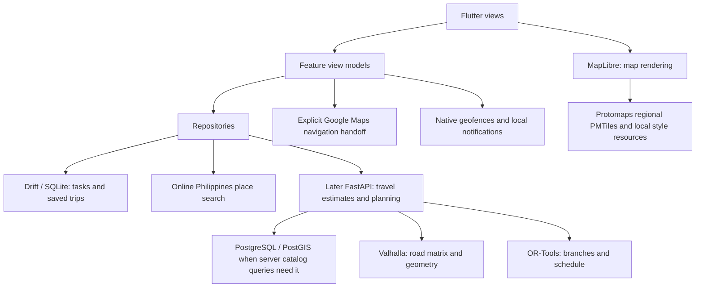

# Planned architecture

Status, 2026-10-27: Android Today, Recurring, and local Drift/SQLite persistence exist at `apps/mobile/`; the browser preview remains in memory. Reconciliation adds an online search adapter, confirmed-place values, map pin selection, manual review, schema migration and legacy-workspace recovery. These additions require integrated Android verification before readiness is claimed. The measured local routing study and versioned planning contract remain feasibility evidence, not production planning. Rudy's bounded place service has been copied into `services/api/` for review; the app does not depend on it. See [README product requirements](../../README.md#product-requirements) and [Decisions](DECISIONS.md) for current product boundaries and rationale.

## Responsibility map



The phone owns personal state and offline regional map data. Per D35, the initial place search is online and Philippines-wide through a Photon-compatible adapter; coverage and reliability still require qualification. A later backend provides real road estimates and automatic planning after feasibility. Map rendering, place search, road routing, stop scheduling, and external navigation are separate responsibilities. Reminder delivery remains later platform work.

## Frontend: features with MVVM

Organize the mobile application around errands, templates, planning, trips, places, and settings. Views display state; Riverpod-backed view models coordinate actions; repositories own data access and caching. Extract domain logic when scheduling or editing behavior would otherwise spread across view models. Avoid a separate abstraction for every simple function.

The frontend root is `apps/mobile/`. The shell uses `app/`, `core/data/` for the Drift database and local startup, shared `core/widgets/`, `features/errands/` for common models/list/editor, and `features/today/` plus `features/recurring/` with Riverpod controllers and repositories. Android repositories persist user changes in SQLite; web preview repositories remain in memory. The broader feature layout below remains planned; create directories when their implementation needs them:

```text
apps/mobile/lib/
  app/                 bootstrap, navigation, theme
  core/                database, network, platform adapters
  features/
    errands/           presentation, domain, data as needed
    recurring/
    planning/
    trips/
    places/
    settings/
```

Widgets do not call SQL or provider APIs directly. Repository contracts return application models rather than provider-specific objects. Cross-feature operations use shared contracts or explicit application services rather than importing another feature's widgets.

The map feature retains the regional offline-package validator and renderer, and adds an online MapLibre pin-selection surface. The shared picker combines search, saved places and map positioning in one route and returns a provider-independent place value. A dedicated search controller debounces input, serializes requests and ignores stale responses; only the latest pending query is retained. Search/map failures retain explicit name-only entry. Camera recentering preserves selected place provenance; user movement creates a manual pin and clears outdated identity/address details. The regional package validator checks its manifest, paths, hashes, PMTiles bounds and local resources. Neither renderer calculates routes or establishes business accuracy.

The shared errand model retains plain-text notes and independent copies. Today settings, errands, Recurring groups and saved places are stored locally on Android. Schema version 2 adds place and errand details without replacing version-1 rows. The recovery flow reads Rudy's workspace and imports into a separate database; when both databases exist, users choose the source and both originals remain. Save failures expose retry. Web preview state remains in memory; no synchronization outbox or account system is present.

Keep limited text parsing on the phone so note entry and correction work offline. Store the original note, explicit edits, and suggestions distinctly. The backend validates the submitted structured constraints; it does not reparse and overwrite confirmed values.

## Next local place and trip boundaries — planned

Use the provider-independent place value for start/end and errands: label, coordinates, optional address, source identity, and source snapshot date. The schema upgrade preserves unresolved legacy labels without inventing coordinates. Recurring copies retain independent place values. Verify upgrade and recovery behavior on Android as well as with synthetic databases.

Keep place search separate from the basemap: vector tiles omit or simplify source attributes and are not the search database. D35 selects online search across the Philippines; choose and validate a provider, filter by country rather than a rectangular approximation, and retain manual selection when unavailable. An installed regional catalog remains a possible later offline capability. Personal pins, notes, and corrections remain separate from replaceable public data. Preserve available provenance and do not overwrite personal edits.

A map package includes PMTiles, the matching style schema, fonts/glyphs, sprites, region bounds, versions, checksums, and license/attribution metadata. Install compatible map/catalog packages atomically and retain the last valid version after interruption or corruption. Record readiness and age. Complete offline rendering must be verified on Android; a remote PMTiles URL is still online.

Save the reviewed automatically planned trip snapshot before external navigation; user order/place changes are explicit overrides that invalidate affected estimates until recalculated. It includes stop coordinates, order, relevant errand details, profile, date/timezone, input revision, and completion state. Edits mark the snapshot stale. External Maps links do not establish arrival, completion, timing feasibility, or synchronization of a user's changes in Google Maps back into Wayday. Use next-stop handoff as primary and bounded whole-trip handoff as optional.

## Backend: modular monolith — later, conditional

Use a single FastAPI application with places, routing, and planning modules. HTTP handlers validate and delegate; services perform domain operations; repositories access PostGIS; adapters translate Valhalla responses. OR-Tools belongs behind the planning module's solver boundary.

The backend root `services/api/` currently contains the imported pilot place-search application under `src/wayday_api/`, plus tests, SQL migrations and import tools. It is not connected to the Flutter app and does not implement routing or planning. The broader domain structure and infrastructure folder below remain planned:

```text
services/api/
  src/wayday/
    core/              settings, database, common errors
    places/            catalog search and source metadata
    routing/           Valhalla adapter and matrix cache
    planning/          validation, solver, itinerary orchestration
  tests/
infra/                 future local deployment configuration
```

The later API may retain reusable route-cache data. Initial place search is intended to use an online provider under D35; a server catalog is optional and must not restrict nationwide search to the pilot. Personal tasks and trip history remain on the phone; plan requests are calculations, not an implicit cloud backup. Avoid logging full notes, home coordinates, or request bodies by default.

Set a solver time limit and bound concurrent work. Keep CPU-bound solves off the async event loop. Start without Redis, a message broker, or separately deployed application microservices; add a worker only if measured load requires one. Hosting Valhalla separately is an engine boundary, not a reason to split every domain module into a service.

## Interfaces to define when development starts

Use REST/JSON under `/v1`, with Pydantic models and generated OpenAPI when the API is implemented. The endpoints below remain future runtime boundaries; Stage 2 specifies the planning payloads without creating a server.

Stage 2 now supplies a versioned [planning contract specification](evidence/planning-contract-v1.md), [JSON Schema](evidence/planning-contract-v1.schema.json) and [synthetic acceptance examples](evidence/planning-contract-v1.examples.json) for the future planning/replanning boundaries. `wayday.planning.v1` separates editable day input from calculated snapshots, correlates request/revision, uses explicit Asia/Manila dates and instants, seconds/meters and provider-independent places. It defines the initial editable duration/buffer policy, single-day behavior, optional prerequisites, bounded candidates/calculation and distinct clarification/conflict/timeout/unavailable results. These are executable contract specifications under `tools/routing/`, not a deployed API, solver or changes to the current Flutter models. The personal-data schema and saved-trip implementation remain their later tasks.

| Interface | Input | Output |
| --- | --- | --- |
| `GET /v1/places` | Search text/category and bounded geographic area | Candidate places, coordinates, source date, opening-hours availability |
| `POST /v1/plans` | Day/date/timezone, start/end, departure/deadline, mode, structured errands, pinned branch choices | Status, selected branches, ordered stops, schedule, geometry, omissions, warnings, calculation time |
| `POST /v1/plans/replan` | Current position/time, completed stops, remaining errands and edits | Replacement schedule for unfinished work, with preserved completed history |
| `GET /health` | No personal data | Application health; distinguish dependency readiness if reported |

Represent the five user-facing choices as transportation profiles: walking, biking, motorcycle, sedan (low clearance), and truck (high clearance). Keep the selected profile separate from engine costing and any validated vehicle parameters. Thread the profile through planning, replanning, saved itinerary metadata, and route-cache identity. Include relevant restrictions and graph version in cache keys so incompatible matrices cannot be reused after a profile change. Public-commute routing is excluded.

The high-clearance category includes pickup/light and heavy delivery vehicle subtypes. Establish the relevant subtype, required dimensions/weight/access parameters, and actual engine/data support before enabling associated restrictions. Ground clearance is not overall vehicle height. A missing road restriction or surface attribute is unknown, not a verified passability result. The profile labels alone must not generate invented dimensions or a guarantee that a road is suitable.

Separate invalid input, missing place data, no road connection, proven infeasibility, solver timeout, and dependency outage. A response that needs review must not be presented as a fully confirmed plan. Exact error objects and limits are an implementation contract task, not invented compatibility guarantees in this foundation.

The first usable release requires system-recommended candidates, selected branches, ordered stops, and estimated timings. Add provider-independent planning input fields for errand category/interpretation state, flexible versus fixed destination, visit-duration estimate/user override, and relevant vehicle subtype/parameters. Keep original text and user-confirmed values; unresolved category or destination information triggers a focused clarification rather than requiring manual itinerary construction.

Use stable errand IDs for dependencies and template copies. Record dates and the IANA timezone (`Asia/Manila` initially); do not reuse the prototype's minutes-after-midnight fields as a complete date model. Treat durations as durations and appointments as local date/time constraints. Define overnight and recurrence edge cases before implementing them.

## Planning pipeline

1. Validate explicit times, durations, coordinates, references, and dependency cycles. Keep ambiguous interpretation outside the solver.
2. Retrieve a bounded set of relevant places for each flexible errand. Respect specific-place overrides and source freshness.
3. Fetch an asymmetric travel-time matrix for the requested mode. Preserve unreachable pairs; never replace them with zero or straight-line travel time.
4. Model branch alternatives, business intervals, appointments, arrival/completion deadlines, service durations, buffers, waiting, and dependencies in OR-Tools.
5. Require exactly one candidate for each mandatory errand; allow at most one for an optional errand. Account for optional dependencies consistently when dropping visits.
6. Enforce hard feasibility first, then favor optional completion and lower travel time. Do not rely on an arbitrary penalty that permits dropping mandatory work.
7. Validate the returned schedule independently of solver construction. Obtain road geometry for the chosen sequence and attach estimate/source metadata.

Respect known business hours for the entire visit. Unknown hours may produce a provisional plan with a visible check-hours notice or explicitly sourced user correction; the model cannot prove availability from missing data. Visit durations use editable, labeled category estimates unless the user provides a value. Record estimate policy/version separately from observed business facts. Report a feasible solution as an optimized estimate, not a proof of global optimality. A time-limited search that finds nothing is not proof that no solution exists.

Replanning starts at the actual current location/time and retains completed history. Do not reroute through completed tasks or replace local edits with an obsolete in-flight response.

## Offline storage and reminders

Local writes to errands, templates, settings, and progress commit immediately to SQLite. Template copies receive their own IDs and remapped internal dependencies. Saving today's copy does not modify its template. No synchronization outbox is required until a server-persistence feature is introduced.

Persist a saved itinerary with stop coordinates, schedule, geometry, source/calculation timestamps, and the input revision it represents. Edits can make a saved plan stale; show this explicitly. Apply network results only to the input revision that requested them. Reconnection does not require silently recalculating or replacing the user's itinerary.

Map downloads include styles, tiles, fonts/glyphs, and sprites needed by the selected region. Verify completion and available storage. Recover gracefully when iOS clears cached tiles. An offline map does not imply offline road routing.

Use `flutter_local_notifications` for time reminders and native Android/iOS geofence APIs for location entry/dwell behavior. Keep a persistent reminder identity to prevent duplicate alerts and cancel stale reminders after replanning. Register relevant upcoming places rather than tracking every saved place.

Request permissions when the user enables the feature. Handle approximate location, denied notification/background access, disabled GPS, delayed delivery, process termination, and reboot. Re-register eligible reminders after restart where the OS permits. Provide time/manual alternatives when geofencing is unavailable. Do not promise exact alerts or guaranteed operation after a force-stop.

See [Android geofencing](https://developer.android.com/develop/sensors-and-location/location/geofencing) and [Apple geographic monitoring](https://developer.apple.com/documentation/corelocation/monitoring-the-user-s-proximity-to-geographic-regions). Apple limits simultaneous monitored conditions to 20; Android geofencing limits differ, so keep platform limits behind the adapter.

## Local deployment and scaling

Initially run FastAPI, PostgreSQL/PostGIS, and a small regional Valhalla graph on the existing computer. The phone must reach that computer to request fresh plans. A laptop that is asleep or disconnected is an unavailable backend, even if the phone has internet.

Document emulator, Android device, and iOS device networking separately. Localhost on a physical phone refers to that phone. Restrict any development HTTP exception to development builds. Do not expose an unauthenticated development API to the public internet.

Later, the API and route engine can move to suitable compute while PostgreSQL moves independently. Supabase is one database candidate. Before public deployment, measure memory, graph size, solver latency, database size, and network use; define access controls, rate limits, TLS, backups, and migration recovery. Free-tier eligibility does not establish that a service can run this workload.

## Verification strategy for later code

- Use fixed matrices to test mandatory/optional work, candidate selection, waiting, opening hours, arrive-by versus finish-before, final deadlines, dependencies, and replanning.
- Compare tiny solver cases with exhaustive enumeration; independently verify every produced schedule.
- Use fixtures for provider adapters, including unreachable legs, timeouts, rate limits, malformed data, and stale responses. Avoid routine tests against community endpoints.
- Exercise all five profiles, bicycle access, confirmed vehicle restrictions, missing clearance data, and profile changes that invalidate cached matrices. Verify that high ground clearance does not bypass truck access or overhead restrictions.
- Exercise SQLite migrations and offline restart with completed stops and edited templates.
- Verify maps and reminders on physical Android/iOS devices, including airplane mode, cache eviction, permission changes, and reboot. Simulator checks alone cannot establish background delivery.
