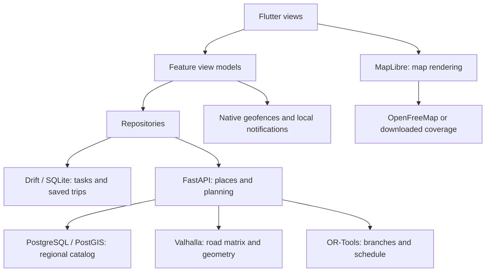

# Planned architecture

Status: the Android UI shell, Today, and Recurring are implemented at `apps/mobile/` with repositories backed by the M1 local workspace when bootstrapped in the app. Unit/widget tests can inject memory repositories. The architecture below remains the target for later capabilities. The backend at `services/api/` now provides a local FastAPI places module, a bounded OSM importer, a PostGIS baseline/adapter and an explicitly configured file snapshot read model for development. M2-03 local PostGIS runtime is verified and is the default catalog mode; routes, scheduling, native reminders and sharing are not operational. The mobile SQLite schema is implemented separately. M2 maps/manual review are described in [MAP_REVIEW_HANDOFF.md](MAP_REVIEW_HANDOFF.md): native map/location adapters stay separate from structured review drafts and future interpretation/planning. Review uses the existing day JSON aggregate and revision-checked confirmation, without a new disk schema.

## Responsibility map



The phone owns personal state and reminder delivery. The backend provides fresh place and planning calculations. Map tiles, road routing, and stop scheduling are independent responsibilities.

## Frontend: features with MVVM

Organize the mobile application around errands, templates, planning, trips, places, and settings. Views display state; Riverpod-backed view models coordinate actions; repositories own data access and caching. Extract domain logic when scheduling or editing behavior would otherwise spread across view models. Avoid a separate abstraction for every simple function.

The frontend root is `apps/mobile/`. The shell uses `app/`, shared `core/widgets/`, `features/errands/` for common models/list/editor, and `features/today/` plus `features/recurring/` with Riverpod controllers, local repository adapters and memory implementations for isolated tests. The broader feature layout below remains planned; create directories when their implementation needs them:

```text
apps/mobile/lib/
  app/                 bootstrap, navigation, theme
  core/                database, network, platform adapters
  features/
    errands/           presentation, domain, data as needed
    templates/
    planning/
    trips/
    places/
    settings/
```

Widgets do not call SQL or provider APIs directly. Repository contracts return application models rather than provider-specific objects. Cross-feature operations use shared contracts or explicit application services rather than importing another feature's widgets.

The current shared errand model includes plain-text notes. Its copy operation carries notes into Today without retaining a mutable link to the template. List/disclosure motion and transient Material feedback live in `core/widgets/`; they have no service or plugin dependency. The M1 workspace hydrates before rendering and serializes transactional SQLite snapshots. Version 1 stores three versioned aggregates (active day, ordered groups and saved places) in a Drift table. Mutations queue in order; save failure exposes Retry. Empty persisted lists never trigger reseeding. Malformed/unsupported data blocks hydration without resetting it. This is one active dated draft, not calendar history. Keep generated schema snapshots and test upgrades before future version changes.

Keep limited text parsing on the phone so note entry and correction work offline. Store the original note, explicit edits, and suggestions distinctly. The backend validates the submitted structured constraints; it does not reparse and overwrite confirmed values.

## Backend: modular monolith

Use a single FastAPI application with places, routing, and planning modules. HTTP handlers validate and delegate; services perform domain operations; repositories access PostGIS; adapters translate Valhalla responses. OR-Tools belongs behind the planning module's solver boundary.

The implemented backend root is `services/api/` with source at `src/wayday_api/`, `places/`, tests, SQL migration and Compose configuration. Routing/planning modules and a separate infrastructure folder below remain planned:

```text
services/api/
  src/wayday_api/
    core/              settings, database, common errors
    places/            catalog search and source metadata
    routing/           Valhalla adapter and matrix cache
    planning/          validation, solver, itinerary orchestration
  tests/
infra/                 future local deployment configuration
```

The initial API stores the regional catalog and reusable route-cache data. Personal tasks and trip history remain on the phone; plan requests are calculations, not an implicit cloud backup. Avoid logging full notes, home coordinates, or request bodies by default.

Set a solver time limit and bound concurrent work. Keep CPU-bound solves off the async event loop. Start without Redis, a message broker, or separately deployed application microservices; add a worker only if measured load requires one. Hosting Valhalla separately is an engine boundary, not a reason to split every domain module into a service.

## Interfaces to define when development starts

Use REST/JSON under `/v1`, with Pydantic models and generated OpenAPI. These are proposed boundaries; there is no frozen wire schema yet.

| Interface | Input | Output |
| --- | --- | --- |
| `GET /v1/places` | Search text/category and bounded geographic area | Candidate places, coordinates, source date, opening-hours availability |
| `POST /v1/plans` | Day/date/timezone, start/end, departure/deadline, mode, structured errands, pinned branch choices | Status, selected branches, ordered stops, schedule, geometry, omissions, warnings, calculation time |
| `POST /v1/plans/replan` | Current position/time, completed stops, remaining errands and edits | Replacement schedule for unfinished work, with preserved completed history |
| `GET /health` | No personal data | Application health; distinguish dependency readiness if reported |

Represent the five user-facing choices as transportation profiles: walking, biking, motorcycle, sedan (low clearance), and truck (high clearance). Keep the selected profile separate from engine costing and any validated vehicle parameters. Thread the profile through planning, replanning, saved itinerary metadata, and route-cache identity. Include relevant restrictions and graph version in cache keys so incompatible matrices cannot be reused after a profile change. Public-commute routing is excluded.

Truck means pickup/light truck per the owner. Before implementing clearance constraints, establish the required dimensions and engine/data support. Ground clearance is not overall vehicle height. A missing road restriction or surface attribute is unknown, not a verified passability result. The profile labels alone must not generate invented dimensions or a guarantee that a road is suitable.

Separate invalid input, missing place data, no road connection, proven infeasibility, solver timeout, and dependency outage. A response that needs review must not be presented as a fully confirmed plan. Exact error objects and limits are an implementation contract task, not invented compatibility guarantees in this foundation.

Use stable errand IDs for dependencies and template copies. Record dates and the IANA timezone (`Asia/Manila` initially); do not reuse the prototype's minutes-after-midnight fields as a complete date model. Treat durations as durations and appointments as local date/time constraints. Define overnight and recurrence edge cases before implementing them.

## Planning pipeline

1. Validate explicit times, durations, coordinates, references, and dependency cycles. Keep ambiguous interpretation outside the solver.
2. Retrieve a bounded set of relevant places for each flexible errand. Respect specific-place overrides and source freshness.
3. Fetch an asymmetric travel-time matrix for the requested mode. Preserve unreachable pairs; never replace them with zero or straight-line travel time.
4. Model branch alternatives, business intervals, appointments, arrival/completion deadlines, service durations, buffers, waiting, and dependencies in OR-Tools.
5. Require exactly one candidate for each mandatory errand; allow at most one for an optional errand. Account for optional dependencies consistently when dropping visits.
6. Enforce hard feasibility first, then favor optional completion and lower travel time. Do not rely on an arbitrary penalty that permits dropping mandatory work.
7. Validate the returned schedule independently of solver construction. Obtain road geometry for the chosen sequence and attach estimate/source metadata.

Respect business hours for the entire visit. Unknown hours require a visible warning or user-supplied assumption; the model cannot prove real-world availability from missing data. Report a feasible solution as an optimized estimate, not a proof of global optimality. A time-limited search that finds nothing is not proof that no solution exists.

Replanning starts at the actual current location/time and retains completed history. Do not reroute through completed tasks or replace local edits with an obsolete in-flight response.

## Offline storage and reminders

Local writes to errands, templates, settings, and progress commit immediately to SQLite. Template copies receive their own IDs and remapped internal dependencies. Saving today's copy does not modify its template. No synchronization outbox is required until a server-persistence feature is introduced.

Persist a saved itinerary with stop coordinates, schedule, geometry, source/calculation timestamps, and the input revision it represents. Edits can make a saved plan stale; show this explicitly. Apply network results only to the input revision that requested them. Reconnection does not require silently recalculating or replacing the user's itinerary.

Map downloads include styles, tiles, fonts/glyphs, and sprites needed by the selected region. Verify completion and available storage. Recover gracefully when iOS clears cached tiles. An offline map does not imply offline road routing.

Use `flutter_local_notifications` for time reminders and native Android/iOS geofence APIs for location entry/dwell behavior. Keep a persistent reminder identity to prevent duplicate alerts and cancel stale reminders after replanning. Register relevant upcoming places rather than tracking every saved place.

Request permissions when the user enables the feature. Handle approximate location, denied notification/background access, disabled GPS, delayed delivery, process termination, and reboot. Re-register eligible reminders after restart where the OS permits. Provide time/manual alternatives when geofencing is unavailable. Do not promise exact alerts or guaranteed operation after a force-stop.

See [Android geofencing](https://developer.android.com/develop/sensors-and-location/location/geofencing) and [Apple geographic monitoring](https://developer.apple.com/documentation/corelocation/monitoring-the-user-s-proximity-to-geographic-regions). Apple limits simultaneous monitored conditions to 20; Android geofencing limits differ, so keep platform limits behind the adapter.

## Local deployment and scaling

Initially run FastAPI, PostgreSQL/PostGIS, and a small regional Valhalla graph on the existing computer. The phone must reach that computer to request fresh plans. A laptop that is asleep or disconnected is an unavailable backend, even if the phone has internet.

Document emulator, Android device, and iOS device networking separately. Localhost on a physical phone refers to that phone. Restrict any development HTTP exception to development builds. Do not expose an unauthenticated development API to the public internet.

Later, the API and route engine can move to suitable compute while PostgreSQL moves independently. Supabase is one database candidate. Before public deployment, measure memory, graph size, solver latency, database size, and network use; define access controls, rate limits, TLS, backups, and migration recovery. Free-tier eligibility does not establish that a service can run this workload.

## Verification strategy for later code

- Use fixed matrices to test mandatory/optional work, candidate selection, waiting, opening hours, arrive-by versus finish-before, final deadlines, dependencies, and replanning.
- Compare tiny solver cases with exhaustive enumeration; independently verify every produced schedule.
- Use fixtures for provider adapters, including unreachable legs, timeouts, rate limits, malformed data, and stale responses. Avoid routine tests against community endpoints.
- Exercise all five profiles, bicycle access, confirmed vehicle restrictions, missing clearance data, and profile changes that invalidate cached matrices. Verify that high ground clearance does not bypass truck access or overhead restrictions.
- Exercise SQLite migrations and offline restart with completed stops and edited templates.
- Verify maps and reminders on physical Android/iOS devices, including airplane mode, cache eviction, permission changes, and reboot. Simulator checks alone cannot establish background delivery.

## Approved sharing extension

[The implementation plan](IMPLEMENTATION_PLAN.md) adds a later sharing module. Personal data stays local unless selected for publication. Owner-authorized shares hold restricted snapshots, latest location, durable confirmed events and subscriptions. Sharing-only authentication, expiring/revocable bearer links, publication preview, private-note exclusion, native FCM and browser/app-link viewing are required. Never log tokens or personal payloads. Protect owner writes and guest reads separately; no personal cloud sync is introduced. Public HTTPS, backup, quota and availability gates precede deployment.


## M2 search and map refinement

Follow [the local API guide](../../services/api/README.md) and decision D22. Search consumes real imported names, addresses and aliases, independently of errand interpretation. The Flutter repository owns HTTP decoding and bounded requests; the chooser debounces queries and rejects stale results. Selected source IDs, addresses, source dates and coordinate kinds persist in the existing version-1 JSON workspace as optional backward-compatible fields; no SQL schema migration is needed. Distinct branches sharing a name retain separate saved-place identities.

The search screen and full map are separate focused routes. Manual selection uses a center pin and read-only coordinates. Canonical source identity is retained within one metre of an existing anchor. Beyond it, optional imported MultiPolygon footprints support containing-place matches; a single mapped point within 10 metres can also match. Containing places take precedence, broad administrative/place boundaries are excluded, and ambiguity requires explicit selection. The pin retains its chosen coordinates with selected_in_mapped_area or near_mapped_point provenance. Unknown pins remain user selections. This does not verify entrances. Android maps use TextureView composition for Flutter overlays. Location is one-time and opt-in; cancellation invalidates the pending result, the overall UI wait is bounded, and stale fixes cannot overwrite later manual choices.

The API stores no personal task database or location history. Local file mode loads a maximum of 20,000 imported pilot records once and never silently replaces a failing PostGIS service. API listeners remain loopback-only, HTTP access logs are disabled, and debug Android HTTP access is separate from a future HTTPS release configuration. Public deployment, accounts and billing remain outside this task. M2-03 database imports, correction retention, rollback, metric queries and outage/restart behavior are now verified; see [the contributor handoff](M2_DATABASE_HANDOFF.md).


## Session-only endpoint refinement

As of 2026-10-18, From and To remain in the running day model for editing/review but are serialized as empty unresolved values in personal snapshots. Hydration validates the whole workspace, then clears any legacy persisted endpoints transactionally without altering errands, saved places or template contents. This revises draft endpoint persistence, not the future saved-itinerary contract. Recurring disclosure starts collapsed in view state. SQL migration 002 independently adds optional imported place footprints for map identity; it does not change SQLite's schema or errand interpretation. See decision D25 and [contributor run modes](RUNNING_WAYDAY.md).
